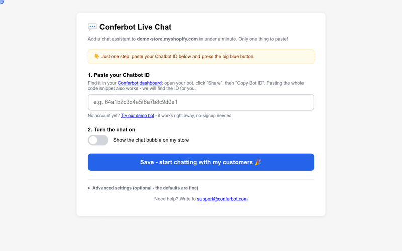

# Conferbot Shopify App

Installs the [Conferbot](https://conferbot.com) AI chat widget on a Shopify storefront. Same product as the [PrestaShop module](https://github.com/Conferbot/conferbot-prestashop), Shopify-shaped: a small embedded Node.js app (App Bridge, session tokens, GraphQL Admin API) plus a **theme app extension** whose app embed block loads the widget on the storefront.

> **0.2.0:** since 1 Oct 2026 Shopify refuses new ScriptTags, so the widget now comes from the app embed block. Stores installed with 0.1.0 keep working; the old ScriptTag is deleted the first time the merchant saves the settings after the upgrade.

## See it in action

Paste the Chatbot ID in the app settings, save, and the chat is live on the storefront (recorded against the mock storefront from the e2e suite):



[HD video (MP4)](docs/demo.mp4)

## How it works

```
merchant clicks install
  -> Shopify-managed install (scopes from shopify.app.toml, no OAuth redirect in this app)
  -> Shopify opens {APP_URL}/app inside the admin
  -> page loads App Bridge, calls /api/settings with a session token (shopify.idToken())
  -> server verifies the token (HS256, client secret, exp/nbf/aud, iss = dest = the shop)
     and exchanges it for an expiring offline access token (stored server-side only)

merchant saves (paste bot ID, flip switch)
  -> GraphQL Admin API: currentAppInstallation { id }, then metafieldsSet
     app-data metafields conferbot.bot_id / enabled / embed_type / script_url
  -> merchant clicks "Open the theme editor" (deep link that switches the
     Conferbot app embed on), then Save in the theme editor

every storefront page load
  -> theme renders the app embed block (extensions/conferbot-embed, target: body)
  -> block reads app.metafields.conferbot.* and boots
     window.ConferbotWidget(botId, embedType, options)
     with { platform: "shopify", shopDomain, storeCurrency, user? }
```

The only merchant-facing setting is the **Chatbot ID** (paste the bare ID, the full embed snippet, or a dashboard URL - the ID is extracted automatically). A public demo bot (`691c970890527a0468f9b2c9`) is offered one-click so the widget works before signing up. Everything visitors see is set per bot in the Conferbot dashboard and delivered at runtime, with nothing to configure in the store: flows and AI agents, live chat with handover to your team (queue position, leave a message when nobody is free, read receipts, file sharing, post-chat rating), the home screen, themes and dark mode, colours, launcher and mascot, greetings, languages and disabled URLs.

The settings page HTML holds no shop data. Reads and saves go through `/api/settings`, which accepts only a valid App Bridge session token and acts only for the shop named in it; anything else gets `401` with `X-Shopify-Retry-Invalid-Session-Request: 1` so App Bridge retries once with a fresh token. The page may only be framed by the shop's admin (`frame-ancestors`).

## Project layout

```
shopify.app.toml           # Shopify CLI app config: URLs, scopes, webhooks (placeholders, no secrets)
shopify.web.toml           # how `shopify app dev` runs this server
extensions/conferbot-embed/
├── shopify.extension.toml # theme app extension
└── blocks/conferbot-embed.liquid  # app embed block: reads the metafields, loads the widget
src/
├── index.js         # entrypoint (listen)
├── server.js        # express app factory: /app, /api/settings, /webhooks/*, legacy /script.js
├── config.js        # env-driven configuration
├── session.js       # App Bridge session-token (JWT) verification
├── shopify.js       # token exchange, GraphQL, app-data metafields, ScriptTag cleanup, webhook HMAC, theme editor link
├── widgetScript.js  # loader JS for 0.1.0 ScriptTags (same loader as the app embed)
├── adminPage.js     # settings page (same UX as the PrestaShop module, plus the app embed step)
└── store.js         # JSON-file shop store (swap for Redis/Postgres via same interface)
test/
├── unit.test.js     # session tokens, metafields, deep link, loader parity with the Liquid block, toml, store
└── e2e.test.js      # full journey against a mock Shopify admin (token exchange + GraphQL), webhooks
```

## Install guide

### Requirements

- A Shopify store on any plan, with an **Online Store** sales channel and an Online Store 2.0 theme (any theme that supports app embeds, e.g. Dawn). The widget runs on Online Store pages; it does not run on checkout or the Thank you / Order status pages.
- A Conferbot account and a bot (free plan is fine), or the demo bot to try it first.
- To host the app yourself: Node.js 18.18 or newer, a public HTTPS URL, a Shopify Partner account and [Shopify CLI](https://shopify.dev/docs/apps/build/cli-for-apps).

### Install from the Shopify App Store

The app is not listed in the Shopify App Store yet. Until it is, install it as a self-hosted app (below), or paste the embed code into your theme (Conferbot dashboard > your bot > Share > Embed into your website > Shopify).

When it is listed: Shopify admin > **Apps** > **Shopify App Store**, search for **Conferbot**, click **Install**. The app asks for no permissions. You land on the Conferbot settings page.

### Install self-hosted (manual)

1. In the [Shopify Dev Dashboard](https://partners.shopify.com) (Partners > Apps): **Create app**. Copy its **Client ID** and **Client secret**.
2. Get the code and configure it:
   ```bash
   git clone https://github.com/Conferbot/conferbot-shopify.git
   cd conferbot-shopify
   npm ci
   cp .env.example .env    # SHOPIFY_API_KEY = Client ID, SHOPIFY_API_SECRET = Client secret, APP_URL
   ```
   In `shopify.app.toml`, set `client_id` to the Client ID and replace every `https://your-app.example.com` with your `APP_URL`. The secret never goes in the toml.
3. Run the server where `APP_URL` points (`npm start`, listens on `:3055`). Keep `data/` on persistent storage: it holds each shop's access token and settings.
4. Push the config and the theme app extension to Shopify:
   ```bash
   shopify app deploy      # app URLs, webhooks, compliance webhooks, conferbot-embed extension
   ```
   For local development, `shopify app dev` does the same against a tunnel and starts the server for you (`shopify.web.toml`).
5. Install on a store: Dev Dashboard > your app > **Distribution** / **Test on development store**, or the install link `shopify app dev` prints. Shopify installs the app and opens the settings page.

### Turn on the app embed

Shopify only adds app code to a theme when the merchant switches it on. On the settings page, step 3 **Open the theme editor (App embeds)** opens `/admin/themes/current/editor?context=apps&activateAppId={client_id}/conferbot-embed`, with Conferbot already switched on: click **Save** there. Manually: **Online Store** > **Themes** > **Customize** > **App embeds** (left sidebar) > **Conferbot chat** on > **Save**. Repeat after switching to a new theme.

### Find your bot ID

1. Sign in at [app.conferbot.com](https://app.conferbot.com) and open your bot.
2. Click **Share**, then **Embed into your website**.
3. The bot ID is the 24-character code inside `ConferbotWidget("...")` in the snippet, e.g. `64a1b2c3d4e5f6a7b8c9d0e1`. It is also in the address bar: `.../chatbot/<bot ID>/embed`.

You can paste the bare ID, the whole snippet, or the dashboard URL; the app pulls the ID out.

### Settings

Open the app from Shopify admin > **Apps** > **Conferbot**.

| Setting | What it does |
| --- | --- |
| **Chatbot ID** | The bot to show. Required before the chat can be switched on. "Try our demo bot" fills a public demo bot. |
| **Turn the chat on** | On/off switch. Off (or no valid ID) makes the app embed render nothing, so nothing loads on the storefront. |
| **Switch on Conferbot in your theme** | Link to the theme editor's App embeds. The chat shows only while the Conferbot app embed is on in the live theme. |
| **How the chat appears** (Advanced) | Floating chat bubble (`live_chat`, default) or popup window (`popup_chat`). |

Everything else (flows, AI agent, live chat handover, colours, launcher, greetings, languages, pages to hide on) is set per bot in the Conferbot dashboard and picked up at runtime.

### Check it works

1. Save with the switch on, and make sure the Conferbot app embed is on and saved in the theme editor.
2. Open your storefront in a private window. The chat bubble appears in the corner within a few seconds; click it and send a message.
3. Not there? View the page source and search for `conferbot-js`: no match means the app embed is off in the live theme, or the switch is off.

### Troubleshooting

- **"Open Conferbot from your Shopify admin"**: the settings API only answers App Bridge session tokens, so the page works only inside the Shopify admin (Apps > Conferbot), not as a bookmarked `{APP_URL}/app` tab.
- **"Could not connect to Shopify" / "Could not save to Shopify"**: the token exchange or GraphQL call failed. Check `SHOPIFY_API_KEY` / `SHOPIFY_API_SECRET` match the Dev Dashboard and the app is installed on that store.
- **No bubble on the storefront**: check the switch is on and the ID is valid, and that **Conferbot chat** is on under App embeds in the *published* theme. A theme or other app that already loads `conferbot-js` (e.g. a hard-coded snippet in `theme.liquid`) wins: the loader skips itself if the widget is already on the page.
- **Bubble shows but not on some pages**: "Disabled URLs" in the bot's Conferbot settings hide it on matching pages. Checkout and the Thank you page never run app embeds.
- **Upgraded from 0.1.0**: the chat keeps loading from the old ScriptTag until you save the settings once; that save deletes the ScriptTag, so switch the app embed on in the same visit. Shopify stops running ScriptTags on 1 Mar 2027 anyway.

### Uninstall

Shopify admin > **Settings** > **Apps and sales channels** > **Conferbot** > **Uninstall**. Shopify removes the app embed and the app's metafields, so the chat leaves the storefront at once, and the `app/uninstalled` webhook deletes the shop's record and access token from this app. Your bot and conversations stay in your Conferbot account.

## Tests

42 tests via the built-in `node:test` runner (41 run, 1 browser test opt-in). Every Shopify API is mocked; no test talks to a real store.

```bash
npm test                    # unit + API-level e2e (mock Shopify admin)
npm run lint                # ESLint
RUN_BROWSER_E2E=1 npm test  # + real headless-Chrome storefront: widget mounts from the CDN
```

The e2e suite runs a mock Shopify admin (token-exchange endpoint and GraphQL Admin API) and drives the real app through: the App Bridge settings page and its `frame-ancestors`, refused session tokens (missing, forged, expired, wrong audience, `iss` not matching `dest`), the token exchange for an expiring offline token and its reuse and renewal, saving a pasted snippet and the exact `metafieldsSet` it sends, per-shop isolation, a failed metafield write, the 0.1.0 ScriptTag cleanup (and a failed cleanup that does not fail the save), and the `app/uninstalled`, `shop/redact`, `customers/data_request` and `customers/redact` webhooks with HMAC checks. Unit tests also check that the Liquid app embed injects the same loader as `/script.js` and that `shopify.app.toml` only holds placeholders.

## Production checklist (before App Store submission)

- [x] `app/uninstalled` webhook to clean up shop records
- [x] GDPR mandatory webhooks (`customers/data_request`, `customers/redact`, `shop/redact`), declared in `shopify.app.toml`
- [x] Session-token (App Bridge) auth for the embedded settings page (#7)
- [x] Theme app extension (app embed) instead of ScriptTag, and GraphQL Admin API (#7)
- [ ] Real Client ID and `APP_URL` in `shopify.app.toml`, then `shopify app deploy`
- [ ] Move the shop store to a real database
- [ ] Billing API if the app itself ever becomes paid (currently free; Conferbot subscription is the product)

## License

MIT.
